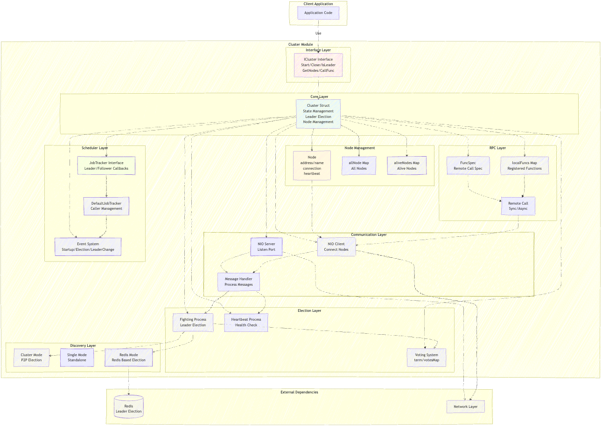

# Cluster 集群管理

`cluster` 提供基于 Raft 共识算法的集群管理能力，包括主节点选举、心跳检测、跨节点远程调用和主从任务调度。

> 导入路径：`github.com/caiflower/common-tools/cluster`



## 特性

| 能力 | 说明 |
| --- | --- |
| 多种模式 | `cluster`（标准集群）、`single`（单机）、`redis`（基于 Redis 选主） |
| 自动选主 | Raft 风格选举，主节点故障后自动重新选举 |
| 心跳检测 | 主节点定期向从节点发送心跳，维护节点存活状态 |
| 远程调用 | 跨节点同步/异步函数调用与 gRPC 服务调用 |
| 任务调度 | 基于集群状态触发主节点/从节点任务 |
| Kubernetes | `ReplicasDiscovery` 自动发现 StatefulSet 副本 |
| 动态扩缩容 | 运行时重新加载节点列表 |

## 目录

- [集群模式](#集群模式)
- [快速开始](#快速开始)
- [核心接口](#核心接口)
- [远程调用](#远程调用)
- [任务调度器](#任务调度器)
- [配置](#配置)
- [集群事件](#集群事件)
- [动态扩缩容](#动态扩缩容)
- [最佳实践](#最佳实践)
- [常见问题](#常见问题)
- [完整示例](#完整示例)
- [相关文档](#相关文档)

## 集群模式

| 模式 | 节点发现 | 节点间通信 | 远程调用 | 典型场景 |
| --- | --- | --- | --- | --- |
| `cluster` | 静态 `Nodes` 或 K8s `ReplicasDiscovery` | TCP 直连 | 支持 | 内网、固定节点或 StatefulSet |
| `single` | 单节点 | 无 | 本地 | 开发、测试、单实例部署 |
| `redis` | Redis 动态发现 | 通过 Redis 选主 | 不支持 | 无法节点直连、弹性伸缩环境 |

> [!NOTE]
> `redis` 模式只负责选主和节点发现，不支持跨节点远程调用。需要远程调用时使用
> `cluster` 模式。

## 快速开始

### 标准集群模式

```go
package main

import (
    "time"

    "github.com/caiflower/common-tools/cluster"
)

func main() {
    config := cluster.Config{
        Mode:    "cluster",
        Timeout: 10 * time.Second,
        Enable:  "true",
    }

    config.Nodes = []*struct {
        Name  string
        IP    string
        Port  int
        Local bool
    }{
        {Name: "node1", IP: "192.168.1.10", Port: 8080, Local: true}, // 当前节点
        {Name: "node2", IP: "192.168.1.11", Port: 8080},
        {Name: "node3", IP: "192.168.1.12", Port: 8080},
    }

    c, err := cluster.NewCluster(config)
    if err != nil {
        panic(err)
    }

    if err := c.Start(); err != nil {
        panic(err)
    }
    defer c.Close()

    // 等待集群就绪
    for !c.IsReady() {
        time.Sleep(time.Second)
    }

    if c.IsLeader() {
        println("当前节点是主节点")
    } else {
        println("当前节点是从节点，主节点是:", c.GetLeaderName())
    }
}
```

> [!NOTE]
> 每个节点应把自己标记为 `Local: true`；未标记时框架会尝试通过 `LOCAL_DNS` /
> `LOCAL_HOST_IP` 自动识别当前节点。

> [!TIP]
> 生产环境不要用 `defer c.Close()` 直接退出，建议把 cluster 注册到
> `global.DefaultResourceManger`，由统一信号处理触发优雅关闭，见
> [最佳实践](#最佳实践)。

### 单机模式

```go
config := cluster.Config{
    Mode:   "single",
    Enable: "true",
}

c, err := cluster.NewCluster(config)
if err != nil {
    panic(err)
}

if err := c.Start(); err != nil {
    panic(err)
}
```

### Redis 模式

```go
import (
    "time"

    "github.com/caiflower/common-tools/cluster"
    redisv2 "github.com/caiflower/common-tools/redis/v2"
)

redisClient, err := redisv2.NewRedisClient(redisv2.Config{
    Addrs:    []string{"localhost:6379"},
    Password: "",
    DB:       0,
})
if err != nil {
    panic(err)
}

config := cluster.Config{
    Mode:   "redis",
    Enable: "true",
    RedisDiscovery: cluster.RedisDiscovery{
        BeanName:           "", // 留空则从 IoC 获取
        DataPath:           "myapp:cluster",
        Port:               8081,
        ElectionInterval:   5 * time.Second,
        ElectionPeriod:     10 * time.Second,
        SyncLeaderInterval: 5 * time.Second,
    },
}

config.Nodes = []*struct {
    Name  string
    IP    string
    Port  int
    Local bool
}{
    {Name: "node1", IP: "127.0.0.1", Port: 8080},
    {Name: "node2", IP: "127.0.0.1", Port: 8081},
}

c, err := cluster.NewCluster(config)
if err != nil {
    panic(err)
}

c.Redis = redisClient
if err := c.Start(); err != nil {
    panic(err)
}
```

> [!IMPORTANT]
> `Cluster.Redis` 的类型是 `redis/v2.RedisClient`。使用 `redis/v1` 的客户端无法赋值。
> Redis Key 结构、动态发现和 Downward API 配置见
> [redis-discovery.md](redis-discovery.md)。

### Kubernetes 模式

在 Kubernetes 中使用 `ReplicasDiscovery` 自动发现 StatefulSet 副本，无需手写 `Nodes`：

```go
config := cluster.Config{
    Mode:    "cluster",
    Timeout: 10 * time.Second,
    Enable:  "true",
    ReplicasDiscovery: cluster.ReplicasDiscovery{
        DomainPatten: "my-service-{suf}.my-namespace.svc.cluster.local",
        Port:         8080,
        PollInterval: 30 * time.Second,
    },
}
```

完整部署要求、扩缩容流程和示例见 [kubernetes.md](kubernetes.md)。

## 核心接口

```go
type ICluster interface {
    // 生命周期
    Name() string
    Start() error
    Close()

    // 状态
    IsClose() bool
    IsReady() bool
    IsLeader() bool
    IsCandidate() bool
    IsFollower() bool

    // 节点信息
    GetLeaderNode() *Node
    GetLeaderName() string
    GetMyNode() *Node
    GetMyName() string
    GetMyTerm() int
    GetMyAddress() string
    GetNodeByName(name string) *Node

    // 节点统计
    GetAllNodeNames() []string
    GetAllNodeCount() int
    GetAliveNodeNames() []string
    GetAliveNodeCount() int
    GetLostNodeNames() []string

    // 任务调度
    AddJobTracker(v JobTracker) error
    RemoveJobTracker(v JobTracker)

    // 远程调用
    RegisterFunc(funcName string, fn func(data interface{}) (interface{}, error))
    RegisterGRPCService(sd *grpc.ServiceDesc, ss interface{}) error
    GetGRPCClient(nodeName string) (grpc.ClientConnInterface, error)

    // Deprecated: 使用 cluster.CallFuncAs[T] 代替
    CallFunc(fc *FuncSpec) (interface{}, error)
}
```

> [!TIP]
> `CallFunc` 返回 `interface{}`，调用方需要自行断言；推荐使用泛型版本
> `cluster.CallFuncAs[T](c, spec)`，避免远程返回值的反序列化问题。

## 远程调用

### 注册函数

被调用的函数必须在所有节点上注册：

```go
func processData(data interface{}) (interface{}, error) {
    input := data.(string)
    return "处理结果: " + input, nil
}

c.RegisterFunc("processData", processData)
```

### 同步调用

```go
import "github.com/caiflower/common-tools/cluster"

spec := cluster.NewFuncSpec("node2", "processData", "test data", 3*time.Second)
spec.SetTraceId("trace-123")

result, err := cluster.CallFuncAs[string](c, spec)
if err != nil {
    fmt.Printf("调用失败: %v\n", err)
} else {
    fmt.Printf("调用结果: %s\n", result)
}
```

### 异步调用

```go
spec := cluster.NewAsyncFuncSpec("node2", "processData", "async data", 3*time.Second)

// 发起异步调用，不等待结果
_, _ = c.CallFunc(spec)

// 稍后获取结果
time.Sleep(time.Second)
result, err := spec.GetResult()
if err != nil {
    fmt.Printf("调用失败: %v\n", err)
} else if result != nil {
    fmt.Printf("调用结果: %v\n", result)
} else {
    fmt.Println("结果尚未返回")
}
```

### 忽略未就绪

```go
spec := cluster.NewFuncSpec("node2", "processData", "data", 3*time.Second)
spec.IgnoreNotReady()
```

### gRPC 服务调用

```go
// 注册 gRPC 服务
if err := c.RegisterGRPCService(&pb.HelloService_ServiceDesc, &helloServiceImpl{}); err != nil {
    panic(err)
}

// 获取目标节点的 gRPC 连接
conn, err := c.GetGRPCClient("node2")
if err != nil {
    panic(err)
}
client := pb.NewHelloServiceClient(conn)
```

## 任务调度器

### 自定义 JobTracker

```go
type MyJobTracker struct {
    cluster cluster.ICluster
}

func (t *MyJobTracker) Name() string { return "MyJobTracker" }

func (t *MyJobTracker) OnStartedLeading() {
    fmt.Println("成为主节点，开始执行主节点任务")
}

func (t *MyJobTracker) OnStoppedLeading() {
    fmt.Println("失去主节点身份")
}

func (t *MyJobTracker) OnStartedFollowing(leaderName string) {
    fmt.Printf("开始跟随主节点: %s\n", leaderName)
}

func (t *MyJobTracker) OnStoppedFollowing() {
    fmt.Println("停止跟随主节点")
}

tracker := &MyJobTracker{cluster: c}
if err := c.AddJobTracker(tracker); err != nil {
    panic(err)
}
```

### DefaultJobTracker

嵌入 `cluster.DefaultCaller` 后只需实现关心的方法：

```go
type MyCaller struct {
    cluster.DefaultCaller
}

func (c *MyCaller) MasterCall() {
    fmt.Println("执行主节点定时任务")
}

func (c *MyCaller) SlaverCall(leaderName string) {
    fmt.Printf("执行从节点定时任务，当前主节点: %s\n", leaderName)
}

caller := &MyCaller{}
tracker := cluster.NewDefaultJobTracker(10, caller) // 每 10 秒调度一次
if err := c.AddJobTracker(tracker); err != nil {
    panic(err)
}
```

### 阻塞模式

默认情况下 `MasterCall` 和 `SlaverCall` 异步执行，每次调度启动新的 goroutine。任务不能并发执行时开启阻塞模式：

```go
tracker := cluster.NewJobTracker(
    cluster.JobTrackerConfig{
        Interval: 10,
        Blocking: true,
    },
    caller,
)
```

阻塞模式下，各 Caller 依次执行；单次任务超过 `Interval` 时下一次调度顺延，同一个 Caller 不会并发执行。

### 关闭

```go
tracker := cluster.NewDefaultJobTracker(10, caller)
defer tracker.Close()
```

## 配置

### Config

```go
type Config struct {
    Mode       string        `yaml:"mode" default:"cluster"`
    Timeout    time.Duration `yaml:"timeout" default:"5s"`
    Enable     string        `yaml:"enable" default:"true"`
    TraceIDKey string        `yaml:"traceIdKey" default:"X-Request-ID"`
    TLS        TLSConfig     `yaml:"tls"`
    Nodes      []*struct {
        Name  string
        IP    string
        Port  int
        Local bool
    } `yaml:"nodes"`
    RedisDiscovery    RedisDiscovery    `yaml:"redisDiscovery"`
    ReplicasDiscovery ReplicasDiscovery `yaml:"replicasDiscovery"`
}
```

| 字段 | 说明 |
| --- | --- |
| `Mode` | `cluster` / `single` / `redis`，未知值回退为 `cluster` |
| `Timeout` | 心跳超时，`time.Duration`，默认 5s |
| `Enable` | 是否启用，字符串 `"true"` / `"false"`，默认 `"true"` |
| `TraceIDKey` | 跨节点调用传递 Trace ID 的 Header 名 |
| `TLS` | 节点间 gRPC 通信的 TLS 配置 |
| `Nodes` | 静态节点列表；`Local` 标记当前节点（测试用） |
| `RedisDiscovery` | Redis 模式配置 |
| `ReplicasDiscovery` | Kubernetes 自动发现配置，见 [kubernetes.md](kubernetes.md) |

### TLSConfig

```go
type TLSConfig struct {
    Enabled  bool   `yaml:"enabled"`
    CertFile string `yaml:"certFile"`
    KeyFile  string `yaml:"keyFile"`
    CAFile   string `yaml:"caFile"`
}
```

### RedisDiscovery

```go
type RedisDiscovery struct {
    BeanName            string        // Redis Bean 名称；为空则从 IoC 获取
    DataPath            string        // Redis Key 前缀
    Port                int           // 节点通信端口，默认 8081
    ElectionInterval    time.Duration // 选主/续约间隔，默认 15s
    ElectionPeriod      time.Duration // 租期，默认 30s
    SyncLeaderInterval  time.Duration // 同步 Leader 间隔，默认 10s
    NodeRegisterTTL     time.Duration // 节点注册信息 TTL，默认 60s
    NodeSyncInterval    time.Duration // 节点列表同步间隔，默认 30s
    NodeHeartbeatPeriod time.Duration // 节点心跳间隔，默认 20s
}
```

`ElectionPeriod` 必须大于 `ElectionInterval`，建议 `NodeRegisterTTL >= 3 * NodeHeartbeatPeriod`。

### ReplicasDiscovery

```go
type ReplicasDiscovery struct {
    DomainPatten string        // 域名模式，{suf} 替换为副本序号
    Port         int           // 服务端口，默认 8081
    PollInterval time.Duration // 轮询 headless service DNS 的间隔，默认 30s
}
```

## 集群事件

| 事件 | 说明 |
| --- | --- |
| `StartUp` | 集群启动 |
| `SignMaster` | 成为主节点 |
| `SignFollower` | 成为从节点 |
| `UnsignMaster` | 失去主节点身份 |
| `UnsignFollower` | 失去从节点身份 |
| `ElectionStart` | 选举开始 |
| `ElectionFinish` | 选举结束 |
| `Close` | 集群关闭 |

事件会触发 JobTracker 的对应回调。

## 动态扩缩容

使用 `ReplicasDiscovery` 时，集群会自动处理扩缩容，详见 [kubernetes.md](kubernetes.md)。

也可以手动触发节点重新加载：

```go
_, err := cluster.CallFuncAs[any](
    c,
    cluster.NewFuncSpec("node2", "cluster.ReloadAllNodes", 3, 2*time.Second),
)
```

## 最佳实践

### 节点配置

- 使用奇数个节点（3、5、7），避免选举平票；
- 至少 3 个节点才能保证高可用；
- 节点间网络延迟应尽可能低。

### 超时设置

```go
config.Timeout = 10 * time.Second

config.RedisDiscovery.ElectionInterval = 5 * time.Second
config.RedisDiscovery.ElectionPeriod = 10 * time.Second
config.RedisDiscovery.SyncLeaderInterval = 3 * time.Second
```

### 节点识别

生产环境建议通过环境变量或配置自动识别当前节点，框架会自动调用
`env.GetLocalDNS()` 和 `env.GetLocalHostIP()`，通常无需手动配置 `Local` 字段。

### 优雅关闭

```go
import (
    "github.com/caiflower/common-tools/global"
)

c, _ := cluster.NewCluster(config)
global.DefaultResourceManger.AddDaemon(c)
global.DefaultResourceManger.Signal()
```

### 远程调用

- 被调用的函数必须在所有节点上注册；
- 设置合理的超时，避免长时间阻塞；
- 异步调用需要定期检查结果或设置超时；
- 参数和返回值必须可序列化；
- 集群未就绪时需要调用时使用 `IgnoreNotReady()`。

### 任务调度

- `MasterCall` 适合只允许主节点执行的任务，如清理、报表；
- `SlaverCall` 适合所有节点执行的任务，如健康检查、数据同步；
- 避免在回调中执行耗时过长的同步操作；
- 关闭时调用 `tracker.Close()` 清理资源。

## 常见问题

### Q1: 集群一直选不出主节点？

可能原因：

- 在线节点少于半数；
- 节点间网络不通；
- 防火墙阻止了节点通信端口。

排查：

```go
fmt.Printf("存活节点: %d/%d\n", c.GetAliveNodeCount(), c.GetAllNodeCount())
fmt.Printf("失联节点: %v\n", c.GetLostNodeNames())
```

### Q2: 主节点宕机后多久重新选举？

通常在 `Timeout * 2` 内完成。例如 `Timeout = 10s`，约 20 秒内完成。

### Q3: Redis 模式和 Cluster 模式有什么区别？

| 特性 | Cluster 模式 | Redis 模式 |
| --- | --- | --- |
| 节点间通信 | TCP 直连 | 通过 Redis |
| 性能 | 高 | 中 |
| 部署复杂度 | 需要节点间网络互通 | 只需连接 Redis |
| 适用场景 | 内网环境 | Kubernetes、容器化环境 |
| 远程调用 | 支持 | 不支持 |

### Q4: 如何处理网络分区？

集群遵循多数派原则：

- 超过半数节点的分区继续工作；
- 少数派分区停止工作，等待网络恢复；
- 节点数为奇数可以避免平票。

### Q5: 如何监控集群状态？

```go
ticker := time.NewTicker(10 * time.Second)
go func() {
    for range ticker.C {
        if c.IsReady() {
            fmt.Printf("集群健康 | 主节点: %s | 任期: %d | 存活: %d/%d\n",
                c.GetLeaderName(),
                c.GetMyTerm(),
                c.GetAliveNodeCount(),
                c.GetAllNodeCount(),
            )
        } else {
            fmt.Println("集群异常，正在选举...")
        }
    }
}()
```

### Q6: Kubernetes 环境如何配置？

见 [kubernetes.md](kubernetes.md)。

### Q7: 如何实现动态扩缩容？

见 [kubernetes.md](kubernetes.md)。

## 完整示例

```go
package main

import (
    "fmt"
    "time"

    "github.com/caiflower/common-tools/cluster"
    "github.com/caiflower/common-tools/global"
)

type BusinessCaller struct {
    cluster.DefaultCaller
    name string
}

func (c *BusinessCaller) OnStartedLeading() {
    fmt.Printf("[%s] 成为主节点\n", c.name)
}

func (c *BusinessCaller) OnStoppedLeading() {
    fmt.Printf("[%s] 失去主节点身份\n", c.name)
}

func (c *BusinessCaller) OnStartedFollowing(leaderName string) {
    fmt.Printf("[%s] 开始跟随主节点: %s\n", c.name, leaderName)
}

func (c *BusinessCaller) OnStoppedFollowing() {
    fmt.Printf("[%s] 停止跟随主节点\n", c.name)
}

func (c *BusinessCaller) MasterCall() {
    fmt.Printf("[%s] 执行主节点任务 - %s\n", c.name, time.Now().Format("15:04:05"))
}

func (c *BusinessCaller) SlaverCall(leaderName string) {
    fmt.Printf("[%s] 执行从节点任务 - 主节点 %s - %s\n",
        c.name, leaderName, time.Now().Format("15:04:05"))
}

func main() {
    config := cluster.Config{
        Mode:    "cluster",
        Timeout: 10 * time.Second,
        Enable:  "true",
    }

    config.Nodes = []*struct {
        Name  string
        IP    string
        Port  int
        Local bool
    }{
        {Name: "node1", IP: "127.0.0.1", Port: 8080, Local: true},
        {Name: "node2", IP: "127.0.0.1", Port: 8081},
        {Name: "node3", IP: "127.0.0.1", Port: 8082},
    }

    c, err := cluster.NewCluster(config)
    if err != nil {
        panic(err)
    }

    caller := &BusinessCaller{name: "node1"}
    tracker := cluster.NewDefaultJobTracker(5, caller)
    if err := c.AddJobTracker(tracker); err != nil {
        panic(err)
    }

    c.RegisterFunc("hello", func(data interface{}) (interface{}, error) {
        return fmt.Sprintf("Hello, %s!", data.(string)), nil
    })

    global.DefaultResourceManger.AddDaemon(c)
    global.DefaultResourceManger.Signal()

    defer tracker.Close()
}
```

## 相关文档

- [Redis 模式动态节点发现](redis-discovery.md)
- [Kubernetes 部署与扩缩容](kubernetes.md)
- 源码：[cluster/cluster.go](../../../cluster/cluster.go)
- 远程调用：[cluster/remote_call.go](../../../cluster/remote_call.go)
- 任务调度：[cluster/scheduler.go](../../../cluster/scheduler.go)
- 文档索引：[docs/README.md](../../README.md)
